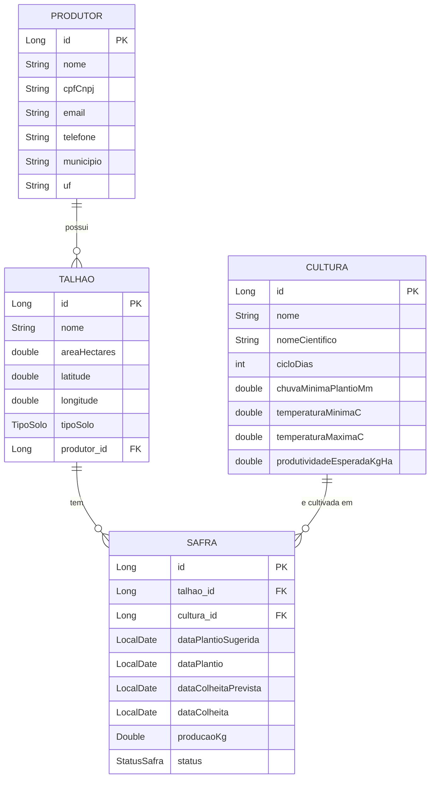

# Diagrama de Entidade e Relacionamento (DER) — GPC

Gerado a partir das classes em `src/main/java/br/edu/ifbaiano/gpc/model`.
O diagrama usa Mermaid (abre direto no GitHub, VS Code com extensão Mermaid e no Claude).

## Enumerações

| Enum          | Valores                                      | Usado em        |
|---------------|----------------------------------------------|-----------------|
| `TipoSolo`    | ARENOSO, ARGILOSO, SILTOSO, HUMIFERO, MISTO  | `Talhao.tipoSolo` |
| `StatusSafra` | PLANEJADA, PLANTADA, COLHIDA, CANCELADA      | `Safra.status`    |

## Relacionamentos

- **Produtor 1 : N Talhão** — um produtor tem vários talhões; cada talhão pertence a um produtor.
- **Talhão 1 : N Safra** — um talhão pode ter várias safras ao longo do tempo.
- **Cultura 1 : N Safra** — uma cultura pode estar em várias safras.
- **Safra** é a entidade associativa entre `Talhao` e `Cultura` (relação N:N resolvida), com dados próprios (datas, produção e status).

## Observações

- Os campos `produtor_id`, `talhao_id` e `cultura_id` são as chaves estrangeiras derivadas das referências de objeto nas classes.
- Os DTOs (`PrevisaoDiariaDTO`, `SugestaoPlantioDTO`) e as classes de integração Open-Meteo não são entidades persistidas, por isso ficam fora do diagrama.
