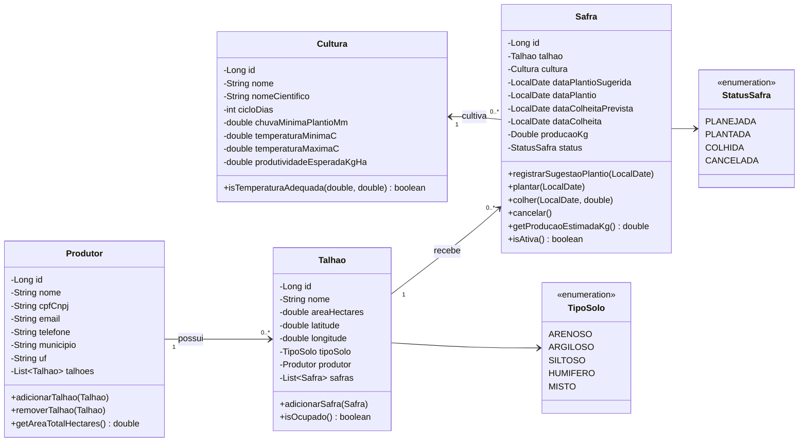
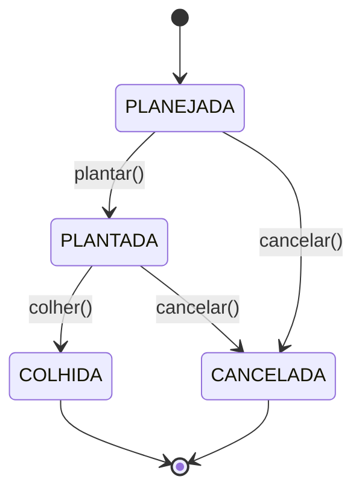

# Diagrama de Classes

Classes do modelo de domínio (`br.edu.ifbaiano.gpc.model`).

## Relacionamentos

| Relacionamento | Cardinalidade | Descrição |
|---|---|---|
| Produtor - Talhão | 1 : N | Um produtor tem vários talhões. Cada talhão pertence a um produtor. |
| Talhão - Safra | 1 : N | Um talhão tem um histórico de safras. |
| Cultura - Safra | 1 : N | Uma cultura pode ser plantada em várias safras. |

A `Safra` liga o `Talhão` à `Cultura`. Ela guarda as datas do ciclo: plantio sugerido, plantio real, colheita prevista e colheita real.

## Ciclo de vida da Safra

