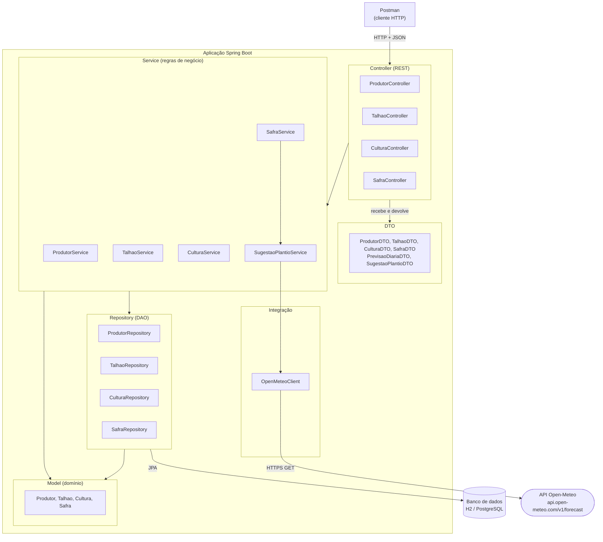
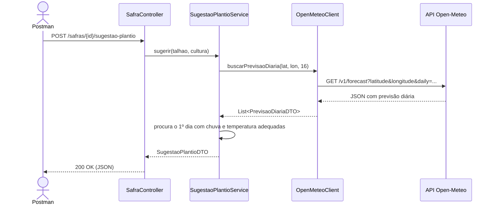

# Diagrama de Componentes

A aplicação usa a arquitetura MVC/REST em camadas. Não há frontend: a resposta JSON é a *View*, testada no Postman.

## Responsabilidade de cada camada

| Camada | Pacote | Responsabilidade |
|---|---|---|
| Controller | `gpc.controller` | Recebe as requisições HTTP e devolve JSON. Não tem regra de negócio. |
| DTO | `gpc.dto` | Define os dados de entrada e de saída da API. Isola o modelo de domínio. |
| Service | `gpc.service` | Aplica as regras de negócio. Exemplo: sugestão da data de plantio. |
| Integração | `gpc.integration.openmeteo` | Chama a API Open-Meteo e converte o JSON para `PrevisaoDiariaDTO`. |
| Repository | `gpc.repository` | Acessa o banco de dados (Spring Data JPA). |
| Model | `gpc.model` | Entidades do domínio e suas regras internas. |

## Fluxo da sugestão de plantio

**Situação na 1ª entrega:** o Model, os DTOs, o `OpenMeteoClient` e o `SugestaoPlantioService` estão implementados. Os Controllers e os Repositories são o próximo passo.
