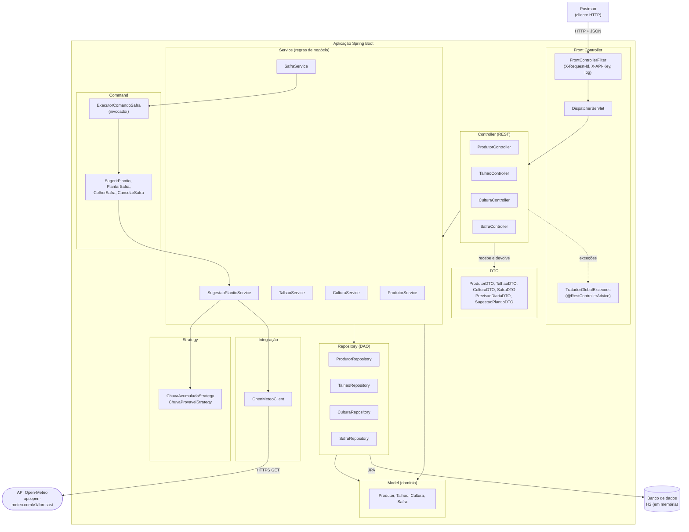
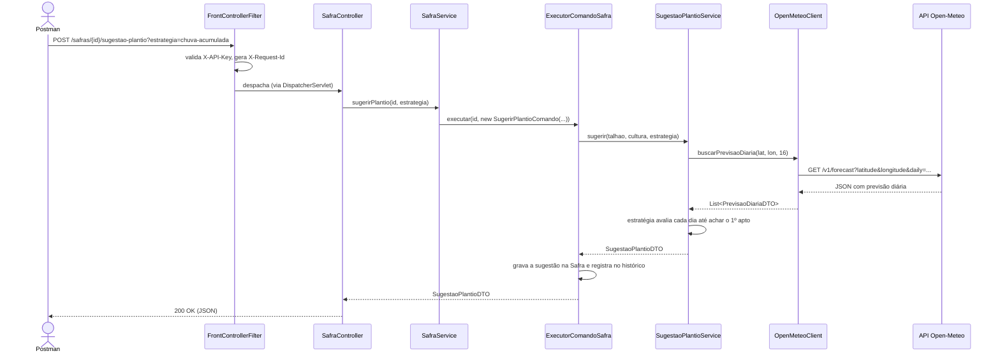

# Diagrama de Componentes

A aplicação usa a arquitetura MVC/REST em camadas. Não há frontend: a resposta JSON é a *View*, testada no Postman.

## Responsabilidade de cada camada

| Camada | Pacote | Responsabilidade |
|---|---|---|
| Front Controller | `gpc.frontcontroller` | Ponto de entrada centralizado: rastreio, autenticação por chave, log e tratamento global de exceções. |
| Controller | `gpc.controller` | Recebe as requisições HTTP e devolve JSON. Não tem regra de negócio. |
| DTO | `gpc.dto` | Define os dados de entrada e de saída da API. Isola o modelo de domínio. |
| Service | `gpc.service` | Aplica as regras de negócio. Exemplo: sugestão da data de plantio. |
| Command | `gpc.command` | Encapsula as operações do ciclo da safra; o invocador executa e registra o histórico. |
| Strategy | `gpc.strategy` | Critérios trocáveis para decidir o dia de plantio. |
| Integração | `gpc.service` (OpenMeteoClient) | Chama a API Open-Meteo e converte o JSON para `PrevisaoDiariaDTO`. |
| Repository | `gpc.repository` | Acessa o banco de dados (Spring Data JPA). |
| Model | `gpc.model` | Entidades do domínio e suas regras internas. |

## Fluxo da sugestão de plantio

**Situação atual:** todas as camadas do diagrama estão implementadas.
