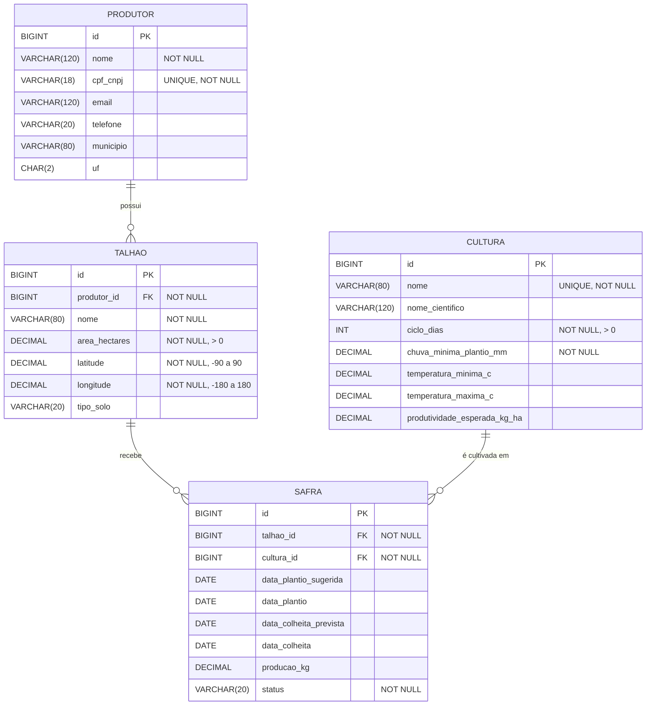

# Modelo do Banco de Dados (DER)

## Regras de integridade

- `SAFRA.status` aceita só: `PLANEJADA`, `PLANTADA`, `COLHIDA`, `CANCELADA`.
- `SAFRA.data_colheita` deve ser igual ou posterior a `SAFRA.data_plantio`.
- Um talhão não pode ter duas safras ativas (`PLANEJADA` ou `PLANTADA`) ao mesmo tempo. O `SafraService` valida esta regra.
- A exclusão de um produtor com talhões é bloqueada (sem `ON DELETE CASCADE`). O mesmo vale para talhão com safras e cultura usada em safras.
- `PRODUTOR.cpf_cnpj` é gravado só com dígitos, para que `123.456.789-00` e `12345678900` sejam o mesmo documento.
- Só safras `PLANEJADA` ou `CANCELADA` podem ser excluídas; as demais fazem parte do histórico.
